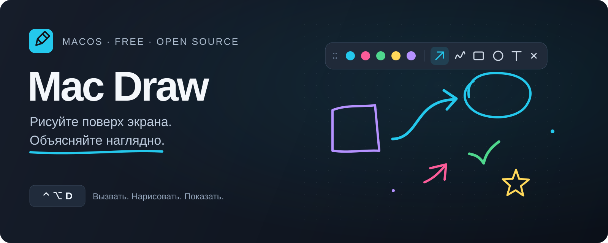

<div align="center">



**Стрелка, пара линий — и всё понятно.**

Бесплатное приложение для macOS: рисуйте поверх браузера, кода и презентаций.

[](https://github.com/vladilenm/mac-draw/releases/latest)
[](https://github.com/vladilenm/mac-draw/releases/latest)
[](LICENSE)

### [Скачать Mac Draw ↓](https://github.com/vladilenm/mac-draw/releases/latest/download/MacDraw-universal.zip)

[Установка](#установка) · [Как пользоваться](#как-пользоваться) · [Ограничения](#честно-об-ограничениях) · [Сообщить об ошибке](https://github.com/vladilenm/mac-draw/issues/new/choose)

</div>

## Зачем это нужно

Когда записываешь урок или показываешь что-то на созвоне, часто хочется просто нарисовать стрелку: «Смотрите, вот сюда». Mac Draw добавляет прозрачный холст поверх открытых приложений. Вызвали панель, выделили нужное, продолжили объяснение.

Подойдёт для записи обучающих видео, разбора кода, демонстрации интерфейсов и презентаций. Приложение работает локально, без аккаунта, подписки и подключения к интернету. Можно использовать бесплатно, в том числе в коммерческих уроках и проектах.

## Что умеет

| Инструмент | Для чего |
| --- | --- |
| Перо | Рисовать от руки и подчёркивать главное |
| Стрелка и линия | Показывать направление, связь или последовательность |
| Прямоугольник и овал | Обводить кнопки, блоки кода и детали интерфейса |
| Текст | Добавлять короткие подписи, в том числе на русском |
| Ластик | Удалять целую линию, фигуру или подпись |
| Режим курсора | Работать с окнами под рисунками, оставляя пояснения на экране |

Шесть цветов, три толщины линии, отмена и повтор. Панель можно перетаскивать за точки слева. Цвет и толщина запоминаются между запусками.

## Установка

**Нужен Mac с macOS 14 Sonoma или новее.** Один архив подходит для Apple Silicon (M1 и новее) и Intel. Для готового приложения не нужны Xcode, Swift, Homebrew или терминал.

1. **[Скачайте MacDraw-universal.zip](https://github.com/vladilenm/mac-draw/releases/latest/download/MacDraw-universal.zip)** из последнего релиза.
2. Распакуйте архив двойным кликом. Внутри — `Mac Draw.app`, `INSTALL.txt` и лицензия.
3. Перетащите **Mac Draw.app** в папку **«Программы»**.
4. Откройте приложение и нажмите **«Начать рисовать»**.

В разделе [Releases](https://github.com/vladilenm/mac-draw/releases/latest) выбирайте `MacDraw-universal.zip`. Автоматические архивы GitHub `Source code` содержат исходники — готового приложения в них нет.

### Если macOS блокирует первый запуск

Публичная сборка имеет локальную **ad-hoc подпись**, но пока **не подписана Developer ID и не заверена Apple**. Поэтому на другом Mac возможно предупреждение, а открытие одним двойным кликом не гарантируется.

Если вы доверяете проекту и скачали архив именно из этого репозитория:

1. Попробуйте открыть Mac Draw и закройте предупреждение.
2. Перейдите в **«Системные настройки» → «Конфиденциальность и безопасность»**.
3. Найдите сообщение о Mac Draw и разрешите запуск кнопкой **«Всё равно открыть» / Open Anyway**. Название зависит от версии и языка macOS.
4. Подтвердите открытие приложения.

macOS запоминает это исключение для приложения. Это стандартный путь, описанный в [инструкции Apple](https://support.apple.com/ru-ru/102445). На управляемом корпоративном Mac запуск может быть запрещён администратором.

Если кнопки нет или система сообщает о повреждённом файле, скачайте архив заново, [проверьте контрольную сумму](#проверка-скачанного-архива) или [соберите приложение из исходников](#сборка-из-исходников).

### Где искать приложение после запуска

Mac Draw живёт **в строке меню macOS**, под значком пера. Значка в Dock нет. После первого запуска окно приветствия может не появляться — нажмите **⌃⌥D** или выберите открытие панели в меню приложения.

## Как пользоваться

1. Нажмите **Control + Option + D** — появится панель инструментов.
2. Выберите инструмент и рисуйте мышью или трекпадом прямо на экране.
3. Нажмите **Esc**, чтобы очистить рисунки и вернуться к обычной работе.

**⌃⌥D и крестик** временно скрывают рисунки и сохраняют их до следующего вызова. **Esc** очищает холст и скрывает панель — при новом вызове экран будет пустым.

Чтобы кликать по приложениям, оставив рисунки видимыми, нажмите **Tab** или кнопку курсора на панели. Для возврата к рисованию выберите любой инструмент. После перехода в другое приложение Tab и остальные обычные клавиши принадлежат ему.

**Текст:** выберите `T`, кликните на экране, введите подпись и нажмите Enter. Esc во время ввода отменяет текущую подпись, очищает остальные рисунки и скрывает панель.

**Ровные фигуры:** удерживайте Shift при рисовании. Прямоугольник станет квадратом, овал — кругом, а линия или стрелка будет привязана к углам с шагом 45°.

### Клавиши

Кроме глобального ⌃⌥D, сочетания действуют, когда фокус находится в Mac Draw. Буквенные клавиши привязаны к физическому расположению и работают при русской раскладке; во время ввода подписи буквы вводят текст.

| Действие | Клавиши |
| --- | --- |
| Показать / скрыть с сохранением рисунков | **⌃⌥D** |
| Очистить и скрыть | **Esc** |
| Перо / стрелка / линия | P / A / L |
| Прямоугольник / овал / текст / ластик | R / O / T / E |
| Выбрать цвет | 1–6 |
| Тоньше / толще | [ / ] |
| Отменить / повторить | ⌘Z / ⇧⌘Z |
| Очистить, оставив панель открытой | ⌘⌫ |
| Режим курсора | Tab |
| Перевести фокус на панель | F6, на некоторых клавиатурах Fn + F6 |

Если ⌃⌥D уже занято, приложение сообщит об этом. Панель можно открыть через значок пера. Изменение глобального сочетания в интерфейсе пока не предусмотрено.

## Для записи видео и созвонов

Выбирайте **захват всего дисплея** в рекордере или программе для созвонов. При захвате отдельного окна прозрачный холст Mac Draw может не попасть в видео. Перед важной записью сделайте короткую пробу со своим рекордером.

Mac Draw сам не записывает видео, не делает скриншоты и не захватывает содержимое других приложений. Разрешение на запись экрана нужно программе, которой вы записываете или транслируете экран.

## Честно об ограничениях

- **Рисунки временные.** После завершения приложения они исчезают. Экспорта PNG/PDF и сохранения проектов нет.
- **Рисунки привязаны к экрану.** При прокрутке страницы или перемещении окна они остаются на прежнем месте.
- **Ластик удаляет объект целиком.** Стереть часть одного штриха пока нельзя. Удаление и очистку можно отменить через ⌘Z в текущем сеансе.
- **Первая публичная версия.** Ручные проверки проведены на Apple Silicon с macOS 15.7.7. Релиз содержит также Intel-код; работа интерфейса на реальном Intel Mac пока отдельно не подтверждена.
- **Несколько дисплеев и полноэкранные Spaces предусмотрены в коде**, но не прошли отдельную ручную проверку. Совместимость со всеми рекордерами и программами для созвонов не заявляется.
- **Первый запуск требует внимания.** Подписи Developer ID и нотариального заверения Apple пока нет. Автообновления и автозапуск при входе в систему не добавлены.
- **Интерфейс на русском.** macOS ниже 14, Windows и Linux не поддерживаются.

Текущее состояние проверок и их границы описаны в [docs/VERIFICATION.md](docs/VERIFICATION.md).

## Приватность

В коде приложения нет сетевых запросов, аналитики, рекламы или отправки данных. Рисунки находятся в памяти процесса; в системных настройках приложения сохраняются выбранные цвет, толщина и факт первого запуска. Приложение не требует разрешений на запись экрана и управление другими программами. Оно регистрирует одно глобальное сочетание клавиш.

## Обновление и удаление

**Обновить:** завершите Mac Draw через значок пера в строке меню, скачайте свежий релиз и замените приложение в «Программах». Новая сборка может снова потребовать разрешения на первый запуск.

**Удалить:** завершите приложение и переместите `Mac Draw.app` из «Программ» в корзину. Сохранённые настройки цвета и толщины могут остаться в стандартном хранилище настроек macOS; рисунков там нет.

### Проверка скачанного архива

Это необязательный шаг. Скачайте `SHA256SUMS.txt` из того же релиза в папку с архивом и выполните там:

```sh
shasum -a 256 MacDraw-universal.zip
```

Сравните результат со строкой для этого файла в `SHA256SUMS.txt`. Контрольная сумма проверяет целостность загрузки; она не заменяет подпись разработчика или проверку Apple.

## Сборка из исходников

Нужны macOS 14+, Swift 6.0+ и macOS SDK из Xcode или Command Line Tools. Версию можно проверить командой `swift --version`. Если инструменты не установлены, выполните `xcode-select --install` и завершите установку в системном окне.

```sh
git clone https://github.com/vladilenm/mac-draw.git
cd mac-draw
./scripts/build.sh
open "build/Mac Draw.app"
```

Скрипт по умолчанию собирает приложение для текущего Mac. Зависимостей из сторонних пакетов нет. Локальная сборка также имеет ad-hoc подпись, но не становится от этого заверенной Apple.

```sh
./scripts/test.sh             # геометрия, история, рендеринг и порядок окон
./scripts/build.sh universal  # один .app для arm64 и x86_64
./scripts/package.sh          # ZIP, инструкция и SHA-256 в dist/
```

Внутри: **Swift + AppKit + SwiftUI**. Геометрия и история находятся в `Sources/DrawingCore`, холст, окна и панель — в `Sources/MacDraw`. Тесты не требуют XCTest или полного Xcode.

## Обратная связь и участие

[Сообщить об ошибке](https://github.com/vladilenm/mac-draw/issues/new/choose) — укажите версию macOS, тип Mac, версию приложения и последовательность действий. Особенно полезны проверки на Intel, нескольких мониторах и с разными программами записи.

Хотите поправить код — см. [CONTRIBUTING.md](CONTRIBUTING.md). Порядок выпуска новой версии описан в [docs/RELEASING.md](docs/RELEASING.md).

## Лицензия

[MIT](LICENSE). Бесплатно для личного и коммерческого использования; можно изучать, изменять и распространять код с сохранением условий лицензии.

Сделано [Владиленом Мининым](https://github.com/vladilenm).
